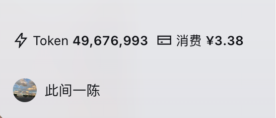
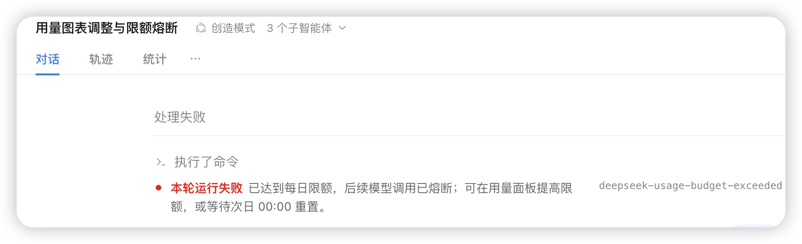
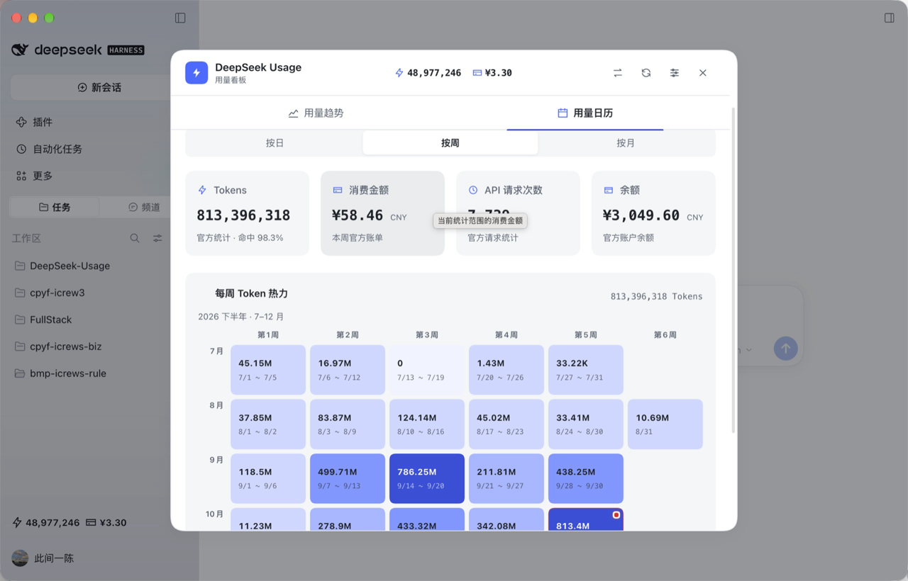
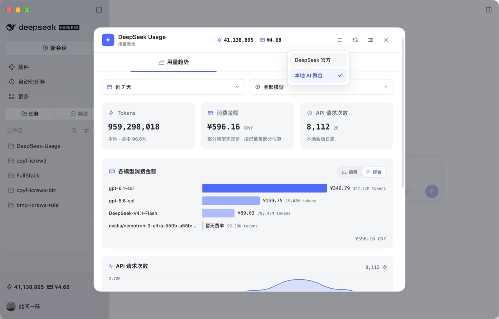
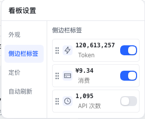

# DeepSeek Usage

> DSH 里的 DeepSeek 用量与预算面板：官方模式读取宿主已登录账号的余额、账单、每日用量与费用；本地模式读取 DSH 全部 Provider 的会话日志，按可编辑的逐模型费率估算 Token、费用和 API 次数，支持用量日历、趋势、模型排行、会话排行与官方/本地对账。支持主题切换，以及侧边栏 Token、消费、API 次数指标的开关、改名、换图标和拖动排序；可设置每日 Token／CNY 限额，达到上限后熔断所有后续模型调用，在状态栏显示红色告警并在对应会话返回失败原因，北京时间次日自动恢复；顶部状态栏与侧边栏共享同一份今日用量快照，保持数据一致。
> 点侧边栏「用量」弹出居中大弹窗：默认走官方账号（不登录、不落盘凭据），可切到本地聚合看 DSH 实际跑了多少。

---

## 界面预览

侧边栏底部常驻一行摘要，不打开面板就知道今天烧了多少——三个指标可以各自开关、改名、换图标：



达到每日限额后不会静默结束：设置页状态条变红提示「已达到每日限额」，当前会话直接显示「本轮运行失败」和恢复方式，后续模型调用被熔断：



| 用量日历（按周热力） | 本地 AI 聚合 · 模型费用排行 |
| --- | --- |
|  |  |

「各模型消费金额」在图表右上角提供 **模型排行 / 费用走势**：模型排行按所选区间的模型费用合计排序，条末标注费用与 Token 用量；费用走势按时间展示金额（当天按小时、跨天按天），合计显示在图表上方，与 Token 模型走势一致。本地 AI 聚合默认模型排行，DeepSeek 官方模式默认费用走势。现有预览截图中的旧名称「综合」对应现在的「模型排行」。

看板设置里的「侧边栏标签」就是侧边栏状态栏配置：三个指标可逐个开关、改名、换内置图标、上传图片和拖动排序。标题旁的 `*` 悬停或聚焦时说明自定义能力，点击每项图标即可更换或上传。其他操作图标也支持悬停／键盘聚焦查看用途：



## 三个优势

### 1. 两种模式：官方 + 本地，互相校正

- **官方模式（默认，免登录）**：面板里没有登录表单，不接收 token，不落盘凭据。取数时按需读一次宿主已登录 DeepSeek 账号的凭据记录，带 `x-dsh-auth-token` 调平台接口。拿到的是账单真值——实际扣了多少钱、余额还剩多少。
- **本地模式**：读 DSH 会话日志里各 provider 上报的 `usage`，回答的是另一个问题：DSH 里到底跑了多少 Token。中转站、OpenAI / Codex 这类非官方路由也一起算进来。
- **为什么两个都得看**：官方账单只有总账，不告诉你钱是哪个模型花的；本地日志可能缺上报，也可能碰上没有定价的模型。只看一边，结论就可能是错的。所以面板同时给覆盖率、差额和逐日 / 逐小时对账，本地金额明确标注「按当前费率估算」「部分模型未定价」，未知模型不按 0 元计入，而是标「暂无费率」。

### 2. 图标与主题都换得动

- **5 套主题色**：DeepSeek 蓝（默认）、官方橙、极客绿、典雅紫、商务红。图表、条形、高亮、选中态全部跟着走。
- **图标可换**：17 个内置图标（钱包、账单、芯片、仪表、数字、时钟…）任选，或直接上传自己的 PNG / JPG / SVG（≤200KB，自动裁成 64×64）。
- **侧边栏三个指标**（Token / 消费 / API 次数）各自开关、改名字、单独配图标，还能拖拽排序，只留你关心的那个。

### 3. 模型价格自己说了算

- 内置 **139 个模型**的四通道费率（未命中输入 / 输出 / 缓存命中 / 缓存写入，USD / 百万 Tokens），覆盖 15 家供应商：Anthropic、OpenAI、Google、DeepSeek、xAI Grok、通义千问、Kimi、智谱 GLM、MiniMax、豆包、腾讯混元、Mistral、Cohere、小米 MiMo、阶跃星辰 Step。
- **单价能改、模型能增删**：「管理定价」里搜索、编辑、新增任意模型，勾选批量删除或点行尾垃圾桶单个删；删掉的默认模型从列表隐藏并按未计价处理，工具栏可一键恢复默认费率与全部模型。
- **汇率可点改**：默认 6.7，在「显示设置 → 定价」直接改，数字显示与输入均居中；改完立刻重算已缓存的 Token，不重读日志。

## 会话用量与每日限额

用量趋势页按 **Token 用量 → 各模型消费金额 → API 请求次数** 排列。Token 卡片右上角提供「会话排行 / 模型走势」切换；选择「本地 AI 聚合」后默认进入会话排行，DeepSeek 官方模式默认进入模型走势；横向条形按当前日期和模型筛选展示每个会话的 Token 数，右侧同时列出 Token 数与预估人民币费用。模型走势按时间展示各模型 Token 用量。子会话默认合并到主会话一行（悬停显示含几个子会话），找不到主会话记录时单列并在名称前标注「子会话/分叉会话」；分叉会话继承的历史消耗不重复计入；未知价格显示「暂无费率」，部分已计价显示「部分」。官方账单没有会话维度，会话排行改用同范围的本机会话日志，但只统计涉及当前官方模型（或已选模型）的会话和对应 Token，标题为「官方模型 · 本机会话 Token」，并在图下注明本机会话合计与官方账单合计，说明本统计与官方口径存在差异、以官方账单为准；只显示 Token 与请求次数，不展示预估金额；官方汇总卡与费用图仍只使用官方账单数据。

设置菜单按「外观 → 侧边栏标签 → 定价 → 每日限额 → 自动刷新」排列。每日限额标题不再带 `*`，标题样式与「汇率配置」一致，为左对齐小标题；统计口径与熔断规则直接写在底部说明。每日限额采用与汇率配置一致的行式显示：未编辑时显示当前上限，点击数值进入编辑，失去焦点或按 Enter 自动保存，编辑时行尺寸不变；正值启用，留空或 0 表示不限，保存成功不新增状态行，失败时显示错误原因。用量跟随当前数据源：本地模式统计本机全部 Provider 的 Token 与当前费率估算，官方模式统计官方账单 Token 与消费；达到任一上限后仍会拦截所有 Provider 的后续模型调用，当前请求正常完成。顶部状态栏与侧边栏共享同一份今日用量快照（同一模式、费率与日期），Token 和消费金额使用同一计算与格式；切换数据源时，弹窗顶部、侧边栏、卡片与设置页使用同一口径。CNY 上限统一显示两位小数，编辑步进 0.01。达到限额时状态条变红并提示「已达到每日限额」，对应会话中也会收到失败原因。打开每日限额先返回配置、再异步加载用量，避免等待官方账单接口。底部说明注明两种模式各自按当前数据源计算熔断，面板内容固定、不上下滚动；限额用量在说明的悬停标题中查看。

配置与费率由宿主保存，重启继续有效；每天北京时间 00:00 开始新日额度，也可提高限额或关闭限制来恢复。恢复额度不会自动继续之前停止的任务。修改模型定价/汇率会同步给宿主，失败时界面明确提示。没有宿主配置编辑能力时不允许保存限额。

按已确认规则，缺失日志或费率时，对应无法完整统计的限额继续放行并显示「统计不完整」。完整的 Token 限额仍可单独生效。费用为估算，供应商上报延迟、在途并发请求、日志删除及缺失用量可能使最终消耗超过限额；插件只约束当前宿主的受控调用。

规则与验收见 [会话用量与每日限额](docs/session-usage-and-budget.md)，业务术语见 [领域词汇表](CONTEXT.md)。

## 它是什么

DeepSeek Usage 把用量数据搬进 DSH，写代码间隙瞄一眼就知道今天烧了多少、余额还剩多少、官方账单和本地日志差多少。

- **总额**：充值余额、累计消费（官方账单口径）。
- **用量图表顺序**：各会话/模型 Token 用量、各模型消费金额、API 请求次数；会话排行和模型费用排行均按横向条形对比。
- **本地 AI 聚合**：直接读 DSH 会话日志里 provider 上报的 `usage`，按天/小时折叠；
  默认包含本机所有 Provider（DeepSeek、中转、OpenAI/Codex 等），不再有
  「DeepSeek 官方 / 全部 Provider」切换。数据源选择会持久化，侧边栏指标
  跟随当前数据源；本地模式不显示约等号，金额注明按当前费率估算（日志覆盖可能不完整，
  不声称与账单等价）；余额仍读取官方账户余额，和本地日志范围无关。
- **本地费用估算**：四通道计价、139 个模型的内置快照、按模型增删改与汇率，见上面「三个优势 · 3」。不按时段切换，未定价模型显示「暂无费率」。
- **用量日历**：当月每日 Token 热力图，5 级深浅，可翻月；切到「按周」/「按月」是跨月的周 / 月汇总热力表。
- **筛选**：时间范围（今天 / 昨天 / 近 7 天 / 近 30 天 / 本月 / 上月）、模型多选。

今日数据按小时展示（和官方用量页同源：`usage/by_api_key` + 本地时区桶）；样式已固化在 `src/panel.css`，类名使用 `d-` 前缀、令牌使用 `--d-` 前缀，全部规则收在 `.d-usage` 作用域，不污染宿主。

## 数据从哪来（不需要登录）

插件**没有登录表单、不接收 token、不落盘凭据**。每次取数时按需读一次宿主的凭据记录：

```
records["deepseek-account-platform/default"].payload.token   // kind: "grant"
```

再带 `x-dsh-auth-token` 头调官方平台的内部接口（抓包确认，非公开 API）：

| 用途 | 端点 |
| --- | --- |
| 余额 / 累计消费 | `GET /api/v0/users/get_user_summary` |
| 用量明细（逐日逐模型） | `GET /api/v0/usage/amount?month=&year=` |
| 费用明细 | `GET /api/v0/usage/cost?month=&year=` |

所以在 DSH 里登录账号 = 这里有数据；在 DSH 里退出账号 = 这里显示「未检测到 DeepSeek 账号」。
上游请求统一带浏览器 UA 与 `x-app-version`，否则平台会回 429。

## 本地聚合（不需要 tokenizer）

本地模式通过宿主可选的 `sessionPersistence` 服务读会话日志，不自己解压 zstd、不建 SQLite、
不依赖 TokenLedger：

```text
persistence.list()                    # 每个会话的 header + revision + sizeBytes
persistence.open(id, 'read')          # 只读句柄，不取得写所有权
handle.read(0)                        # 全部事件
handle.close()
```

折叠口径直接采用 DSH 的 provider-reported usage：

- 四桶互斥：`cacheReadTokens` → 命中、`inputTokens` → 未命中、
  `cacheWriteTokens` → 缓存写入、`outputTokens` → 输出；`reasoningTokens` 是输出子集，不重复加。
- 同一 `(turn, step)` 的最终 `assistant/message` **替换** chunk 样本，不累加。
- Provider/model 取 `message.source`，缺失时回退最近一次 `request/header`，再缺失记 `unknown`。
- 只缓存折叠结果，不保留事件；`revision` 未变不重读；30s TTL、并发去重。

本地看到的不是官方账单的全集：官方包含所有客户端/机器，本地只含本机 DSH 会话；
本地还会包含中转/API Key 路由，也会因日志清理而缺失历史。所以对账条同时显示覆盖率和 caveat，
不假装两边 1:1。

## 安装

### DSH 桌面 App（官方客户端）

桌面 App 的 `desktop` profile 由 Electron 独占，**不能**用 `dsh plugin --profile desktop` 安装（会报 `profile "desktop" is managed exclusively by the Electron application`）。

在 App 内操作：

1. 打开 **设置 → 插件**
2. 点右上角的 **+ / Add plugin**
3. 输入 npm 包名 `deepseek-usage`；本地开发可填本仓库的绝对路径
   （如 `/Users/you/IdeaProjects/DeepSeek-Usage`，按 `link:` 处理，改代码后刷新即可）
4. 安装完成后完全退出并重开 DSH（⌘Q）

### Web 版 / CLI

先确认 `dsh` 命令可用（DSH 桌面 App 不自带 CLI）：

```bash
dsh --version
```

没有的话，安装与 App 同版本的 CLI（把版本号换成你的 App 版本）：

```bash
npm install -g @deepseek-ai/dsh@0.2.1-rc.3
```

然后按实际使用的 profile 安装（Web 版是 `web`）：

```bash
dsh plugin --profile web add deepseek-usage
```

从源码安装（开发调试）：

```bash
dsh plugin --profile web add github:sdiwenchen-lang/DeepSeek-Usage
```

装好后**重启 DSH** 生效：客户端 bundle 在启动时一次性加载。侧边栏会多出一枚
「DeepSeek Usage · 用量」按钮，点开即是面板。

> 刚启动的那一屏可能还没有第三方插件的入口：桌面端窗口先于宿主插件图加载，客户端会
> 因 “Host release changed” 暂停插件更新。**刷新一次页面（⌘R）**即可看到入口，之后一直保留。`package.json` 的 `dsh.bundle.patch` 指向
`cordis.patch.yml`，宿主加载 bundle 时自动应用补丁。

### 可配置项（都有默认值，可不写）

```yaml
- id: deepseek-usage-panel
  name: deepseek-usage
  config:
    xAppVersion: "0.1.0"                # 发给上游的 x-app-version
    requestTimeoutMs: 10000             # 单次上游请求超时
    cacheTtlMs: 600000                  # 缓存 TTL（10 分钟）
    lookbackMonths: 24                  # 月份回看上限（覆盖整年）
    retryBackoffMs:                     # 429 / 5xx 退避序列
      - 1000
      - 2000
      - 4000
    local:
      sweepTtlMs: 30000                 # 本地会话日志扫描 TTL
      maxSessions: 5000                 # 单次扫描上限
      officialProviders:                # 算作「官方计费路由」的 provider
        - deepseek-official
        - deepseek-account
        - deepseek
      pricing:                          # 可选：本地费用估算
        enabled: true
        # usdToCny: 自定义汇率；留空/0 使用内置默认 6.7
        # models:                       # USD / 百万 Tokens，四项缺一不可
        #   custom-model:
        #     input: 1
        #     output: 4
        #     cacheRead: 0.1
        #     cacheWrite: 1.25
```

默认费率来自 `src/pricing.snapshot.json`，快照日期 2026-10-30，共 139 个模型，覆盖 15 家供应商：Anthropic、OpenAI、Google、DeepSeek、xAI Grok、通义千问、Kimi、智谱 GLM、MiniMax、豆包、腾讯混元、Mistral（含 Devstral / Codestral）、Cohere、小米 MiMo、阶跃星辰 Step。保留每个家族的最新与次新版本和兼容别名，剔除预览 / 实验版本、日期别名和推理档位别名；美元兑人民币默认按内置 6.7 估算。DeepSeek 采用高峰价（USD / 百万 Tokens，命中 / 未命中 / 输出）：V4.1 Flash `0.006 / 0.30 / 1.20`，V4 Flash（旧版/兼容）`0.014 / 0.44 / 1.32`，V4 Pro `0.044 / 1.32 / 3.96`；面板不区分峰谷时段。汇率可在「显示设置 → 定价」直接点击修改；在「管理定价…」中可搜索、编辑或添加模型，可勾选行批量删除或点行尾垃圾桶删除；删除默认模型会将其从定价列表隐藏并按未计价处理，工具栏可恢复默认费率与全部模型；浏览器只保存 USD 稀疏覆盖和本地隐藏列表。旧人民币峰谷配置保留但不直接迁移。

公式为 `(未命中输入×input + 输出×output + 缓存命中×cacheRead + 缓存写入×cacheWrite) / 1,000,000` 美元，再按内置 6.7 的汇率换算为人民币。「消费金额」卡只显示人民币金额，点击不跳转。未知模型不当免费；空/未来用量为零。部分已定价的金额仅代表已覆盖部分，响应标记 `complete: false` 和 `unpricedModels`。修改费率会重算已缓存 Token，不重读未变化日志。

## 插件自有端点

全部只监听回环地址，并做双重校验（peer socket 必须是 `127.0.0.1` / `::1`，Host 头也必须是回环），
任一不满足返回 403。

| 端点 | 作用 |
| --- | --- |
| `GET /api/deepseek-usage/pricing` | 有效四通道 USD 费率、生效汇率与快照元信息 |
| `GET /api/deepseek-usage/status` | 数据源状态：是否检测到账号、数据源引用、是否降级 |
| `GET /api/deepseek-usage/summary?year=&month=` | 余额 + 指定月份逐日逐模型用量与汇总（日历页数据） |
| `GET /api/deepseek-usage/official?range=today\|yesterday\|last7\|last30\|thisMonth\|lastMonth` | 官方用量；也接受 `from=YYYY-MM-DD&to=YYYY-MM-DD&tz=`（最多 800 天）。按自然月精确分片，保留首尾部分月份，未来日期补零且不请求上游 |
| `GET /api/deepseek-usage/local?range=…&scope=all\|deepseek&tz=&rates=` | 本地会话日志的逐日/逐小时 Token、模型、Provider、缓存命中率、coverage 与 `cost` / `costMeta`（当前费率估算）；默认 `scope=all`，`rates` 可覆盖费率，`hidden` 列表按未计价处理；也接受 `from=&to=` 自定义范围 |
| `GET /api/deepseek-usage/reconcile?range=…&scope=…` | 同一范围官方 vs 本地：覆盖率、差额、逐日/逐小时对账；官方未登录或本地不可用时降级一侧 |
| `GET /api/deepseek-usage/panel.css` | 面板样式表（约 112KB，独立下发，见「体积预算」） |

## 代码结构

```
DeepSeek-Usage/
├── src/
│   ├── index.js        # Cordis 入口：name / inject / optional / apply，装配依赖、注册命令
│   ├── http.js         # 回环端点、loopback 栅栏、summary/official/local/reconcile 聚合与缓存
│   ├── apiclient.js    # 唯一允许出现 platform.deepseek.com 的地方：端点、鉴权头、字段映射、重试
│   ├── account.js      # 只读宿主 credentials 里的 DeepSeek 账号（60s 缓存、并发去重）
│   ├── cache.js        # TTL + in-flight 去重
│   ├── local-fold.js   # 纯折叠：usage 事件 → 小时/route 桶；同 (turn, step) 替换
│   ├── local.js        # 本地数据源：sessionPersistence 扫描、revision 缓存、范围聚合
│   ├── pricing.js      # 四通道 USD 费率、显式 FX、缓存分析与费用覆盖率
│   ├── pricing.snapshot.json # 139 个主流模型离线默认费率
│   ├── reconcile.js    # 官方 vs 本地对账 payload
│   ├── client.js       # 浏览器半边：__ModuleLoader__ bundle，React 组件与图表（纯 SVG）
│   └── panel.css       # 面板样式（由 /panel.css 下发）
├── cordis.patch.yml    # bundle 补丁（安装入口）
└── package.json
```

服务端是纯 Node 标准库 + 宿主注入的 `credentials` / `sessionPersistence`，无运行时依赖、无构建步骤；
前端 bundle 手写 `__ModuleLoader__.load({ id, factory })`，React 由宿主作为 peer 提供。

## 开发检查

```bash
npm test               # 离线 mock API、计价、本地聚合与客户端回归
npm run bundle:check   # 客户端 bundle 体积上限 124KiB（126976B）
```

几个非显然、改代码前必须知道的约束：

- **客户端 bundle 只能导出 `apply` / `inject`**。导出 `default` 会让宿主 fiber 卡在 loading，整个 web 启动失败。
- **bundle 上限 124KiB**，而面板样式有 ~112KB。所以样式走 `/api/deepseek-usage/panel.css` 单独下发，
  客户端只注入一个 `<link>`；把 CSS 塞回 `client.js` 会直接超限。
- **`inject` 里只声明真用到的服务**：`credentials` 必须；`webServer` / `httpServer` / `commands` /
  `sessionPersistence` 是可选的，用 `ctx.get()` 探测——Cordis 4 下直接读 `ctx.commands` 会抛错。
  `sessionPersistence` 缺失时 `/local` 返回 503，官方模式不受影响。
- **本地聚合不要在插件里解压 zstd**：会话日志是多 frame 追加，`zlib.zstdDecompressSync` 只读第一帧；
  一律走宿主句柄的 `read(0)`。
- **上游字段名会变**，映射集中在 `apiclient.js` 的 `FIELD_MAP`，改一处即可。

## 打包（本地分发包）

没有构建步骤：服务端只用 Node 标准库，前端 `client.js` 手写 `__ModuleLoader__` bundle，
所以「打包」就是 `npm pack`，产出物可直接装进 App 或发给别人。

```bash
npm run bundle:check     # 先过体积门禁（客户端 bundle ≤ 124 KiB，超了会被挡下）
npm pack                 # 产出 deepseek-usage-<version>.tgz
npm pack --dry-run       # 只看会进包的文件清单，不落盘
```

`package.json` 的 `files` 决定包内内容：`src/`、`cordis.patch.yml`、`README.md`、
`CHANGELOG.md`、`LICENSE`。**`cordis.patch.yml` 是安装入口**（`dsh.bundle.patch` 指向它），
漏掉它包能装、但 UI 不会出现任何入口。

装进桌面 App：

1. **设置 → 插件 → + / Add plugin**
2. 选 **本地压缩包**，填 `.tgz` 绝对路径；或选 **本地目录**，填仓库根目录
   （按 `link:` 处理，改完代码刷新页面就生效，适合反复调试）
3. 装完 ⌘Q 完全退出再打开，刷新一次（⌘R）能看到侧边栏入口

CLI（Web 版 profile）：

```bash
dsh plugin --profile web add ./deepseek-usage-0.1.4.tgz
dsh plugin --profile web remove deepseek-usage
```

桌面端的 `desktop` profile 由 Electron 独占，**不能**用 `dsh plugin --profile desktop`
装（报 `profile "desktop" is managed exclusively by the Electron application`），
只能在 App 页面里操作。另外 pnpm 11 默认有 24 小时隔离期
（`minimumReleaseAge=1440`），从 npm 装**刚发布**的版本会被 `ERR_PNPM_NO_MATCHING_VERSION`
挡住，等满 24 小时或改用本地 `.tgz` / 目录安装。

发版时同时更新 `CHANGELOG.md` 与 `package.json` 的版本号，并在 GitHub 上用同名
tag 建 Release——正文就是插件市场「更新内容」里显示的版本说明。

## 体积与性能预算

| 项 | 预算 | 实测 |
| --- | --- | --- |
| 客户端 bundle | ≤ 126976B | 126203B（0.1.7 验证） |
| 面板样式 | 独立下发 | ~112KB |
| 侧边栏摘要 | 每 120 秒刷新当前数据源 | 同费率口径 |
| 图表渲染 | 纯 SVG，≤ 5ms | 满足 |
| 本地 126 个会话首次折叠 | < 5s | ~2.3s |
| 本地增量折叠 | 只重读 revision 变化的会话 | 满足 |

## 安全与隐私

- 凭据只经宿主 credentials 服务按引用读取，**不写文件、不下发浏览器、不进日志**。
- token 只出现在 `x-dsh-auth-token` 请求头，不进 URL。
- 自有端点仅回环，`screenRequest` 双校验 peer socket 与 Host。
- 面板按打开、范围切换和手动刷新取数；侧边栏每 120 秒更新摘要。官方月度分片有 TTL 与 in-flight 去重，纯未来范围不读取账号或调用上游。

## 已知限制

- 依赖 platform.deepseek.com 的内部接口，官方无承诺，接口变动需改 `apiclient.js`。
- 只覆盖 platform 账号（即 DSH 已登录的那个），API Key 用量不在范围内。
- 热力图固定当月，跨年回看以月为单位。

## License

MIT，见 [LICENSE](./LICENSE)。
