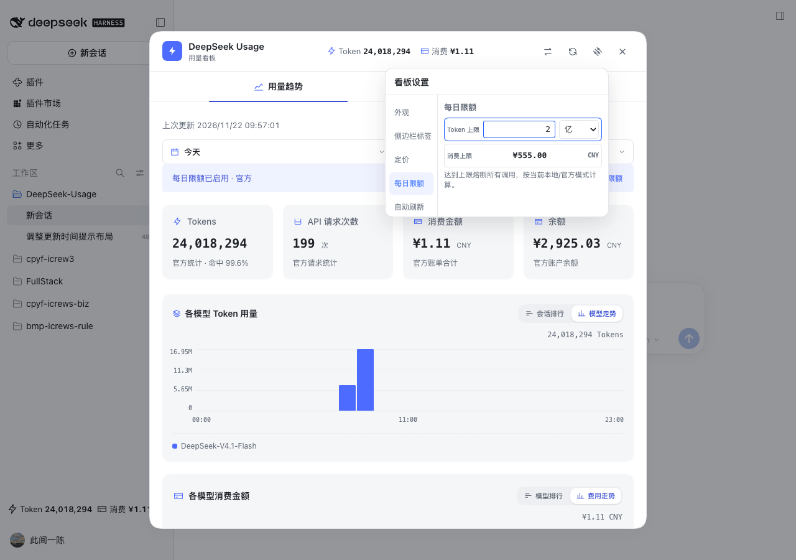

# 每日限额输入框被挤到无法使用（1.0.1 → 1.0.2）

## 现象

「显示设置 → 每日限额」里 Token 上限的数字输入框只剩十几到四十像素，几乎点不进去、也看不清数值；同一行的单位下拉和面板其它按钮正常。用户反馈：「每日限额 对应 token 限额 设置不了」。

## 复现与测量

在桌面 profile 的克隆里用 Playwright 打开真实面板（窗口 1280×900），读取 `getBoundingClientRect()`：

| 版本 | 设置面板宽 | 左导航列 | 限额行宽 | 输入框宽 | 结果 |
|---|---|---|---|---|---|
| 1.0.1 | 290px | 100px | 318px（超出面板 53px） | 41.9px | 行溢出被 `overflow:hidden` 裁掉，单位下拉右侧被切 |
| 1.0.2 | 360px | 84px | 254px（贴合面板） | 115.9px | 完整可见，可点击、可输入 |

1.0.1 的行宽 318px 来自 `.d-budget-settings` 的隐式网格列按 min-content 撑开，而 `.d-fx-input` 的基础规则是 `flex: 1 1 0; width: 0; min-width: 0`——网格列比容器宽 53px，输入框又被压缩到 0 再按剩余空间分配，于是只剩几十像素。

## 修复

`src/panel.css`（1.0.2）：

- `.d-settings-panel.d-settings-tab-budget`：面板宽 `min(360px, 100vw - 24px)`，网格列改为 `84px minmax(0, 1fr)`。
- `.d-budget-settings`：显式 `grid-template-columns: minmax(0, 1fr)`，不再让隐式列按 min-content 溢出。
- `.d-budget-settings .d-fx-input`：`flex: 1 1 96px; width: auto; min-width: 96px; text-align: right`。
- `.d-budget-settings .d-fx-row`：`min-width: 0; max-width: 100%`。
- `≤560px`：限额行 `flex-wrap: wrap`，输入框 `flex: 1 1 100%`，窄屏也不会被压成一条缝。

守护：`test/panel-css.test.js` 断言上述宽度/网格/换行规则存在（115 项测试通过）。

## 证据

验证方式：把 1.0.2 的 tgz 同步进桌面 profile 克隆，重启 `dsh --profile <clone> --port 0 --no-open`，用 Playwright 真实鼠标点击打开面板 → 每日限额，测量并实际输入 `2`（`document.activeElement` 为该输入框，值为 `2`）。

## 未覆盖

真实 Electron 桌面包（「更新」按钮那条流水线）没有在本机重放，只验证了同一 profile 的 web 宿主；两者共用同一份 `panel.css` 与面板 DOM。
