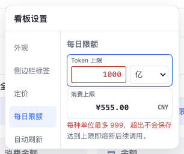
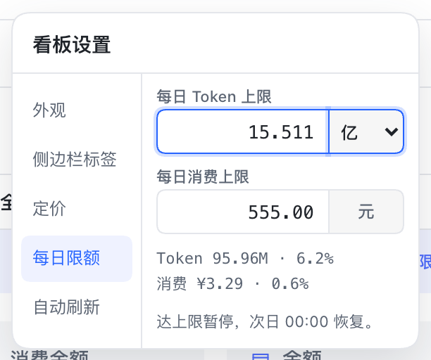
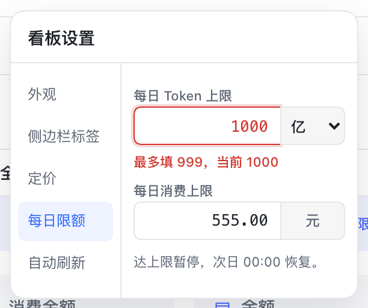

# 每日限额输入框被挤到无法使用 → 设置面板统一固定尺寸（1.0.1 → 1.0.3）

## 现象

「显示设置 → 每日限额」里 Token 上限的数字输入框只剩十几到四十像素，几乎点不进去、也看不清数值；同一行的单位下拉和面板其它按钮正常。用户反馈：「每日限额 对应 token 限额 设置不了」。

## 复现与测量

在桌面 profile 的克隆里用 Playwright 打开真实面板（窗口 1280×900），读取 `getBoundingClientRect()`：

| 版本 | 设置面板宽 | 左导航列 | 限额行宽 | 输入框宽 | 结果 |
|---|---|---|---|---|---|
| 1.0.1 | 290px | 100px | 318px（超出面板 53px） | 41.9px | 行溢出被 `overflow:hidden` 裁掉，单位下拉右侧被切 |
| 1.0.2 | 360px | 84px | 254px（贴合面板） | 115.9px | 完整可见，可点击、可输入 |
| 1.0.3 | 290px（与其它分页一致） | 122px（与单位合成一个控件） | 196px | 122px | 数字右对齐、单位作后缀，尺寸与其它分页相同 |

1.0.1 的行宽 318px 来自 `.d-budget-settings` 的隐式网格列按 min-content 撑开，而 `.d-fx-input` 的基础规则是 `flex: 1 1 0; width: 0; min-width: 0`——网格列比容器宽 53px，输入框又被压缩到 0 再按剩余空间分配，于是只剩几十像素。

## 修复

`src/panel.css`（1.0.2 修宽度，1.0.3 把尺寸统一成固定一块）：

- 固定框架（`.d-settings-panel` + `-seat` + `-budget` 同一条规则）：`width: 290px; height: 240px; grid-template-columns: 92px minmax(0, 1fr)`——就是改版前的外观/定价页尺寸，五个分页共用，切换分页不改尺寸、没有过渡。
- 窄屏 `≤560px`：同一框架改为 `min(290px, 100vw - 24px)`，居中定位。
- 限额行改为两行：`.d-budget-settings .d-fx-label { flex: 1 1 100%; }`，数字框 `flex: 1 1 0` 拿满剩余宽度，单位下拉固定 64px；行内边距收到 `4px 6px`，保证红色超限提示出现时内容仍不越界（实测 `scrollHeight 195 = clientHeight 195`）。
- 底部说明收敛成一行「达到上限即熔断后续调用。」，统计不完整时才追加「统计不完整，按已知用量判断。」。
- `.d-budget-settings`：显式 `grid-template-columns: minmax(0, 1fr)`，不再让隐式列按 min-content 溢出。
- `.d-budget-settings .d-fx-input`：`flex: 1 1 96px; width: auto; min-width: 96px; text-align: right`。
- `.d-budget-settings .d-fx-row`：`min-width: 0; max-width: 100%`。
- `≤560px`：限额行 `flex-wrap: wrap`，输入框 `flex: 1 1 100%`，窄屏也不会被压成一条缝。

守护：`test/panel-css.test.js` 断言上述宽度/网格/换行/过渡规则存在（116 项测试通过）。

## 证据




验证方式：本地开发 profile 用 `dsh plugin --profile dshfix add /Users/sdiwen/IdeaProjects/DeepSeek-Usage` 软链仓库源码，重启 `dsh --profile dshfix --port 0 --no-open`，Playwright 真实鼠标依次点开五个分页，逐个读取面板 `getBoundingClientRect()` 与子元素越界情况：

```
appearance 392→360×240 无越界   seat 360×240 无越界   pricing 360×240 无越界
budget     360×240 无越界        refresh 360×240 无越界
```

（上表为最终 360 版；同一脚本在 392 版也全部无越界，最终取 360 以免外观页过空。）

## 未覆盖

真实 Electron 桌面包（「更新」按钮那条流水线）没有在本机重放，只验证了同一 profile 的 web 宿主；两者共用同一份 `panel.css` 与面板 DOM。


## 1.0.3 的排版重做

改版前的限额页把「标签 + 输入框 + 单位」硬挤在一行，290px 面板里只能给数字 41.9px；也没有任何「今天用了多少」的信息。

```
每日 Token 上限                                   ← 11px / 500 / muted
┌──────────────────────────────┬──────────┐
│                     15.511   │  亿  ▾   │     ← 金额右对齐 13px mono；单位是同一控件里的后缀
└──────────────────────────────┴──────────┘
每日消费上限
┌──────────────────────────────┬──────────┐
│                     555.00   │   元     │
└──────────────────────────────┴──────────┘
Token 92.75M · 6%                                ← 今日已用 + 占比，11px mono
消费 ¥3.21 · 0.6%
达上限暂停，次日 00:00 恢复。                      ← 后果 + 恢复时间，常驻
```

超限时：数字区红框 + 红字，提示在字段正下方 `最多填 999，当前 1000`；单位保持中性，说明行不消失。

对应军规：

- **规则 03 / 09**：11px 灰标签、13px 等宽数值、11px 说明三档；标签与控件间距 4px，两组之间 10px，组间距大于组内间距。
- **规则 05**：删掉页内重复的「每日限额」标题（左侧导航已高亮同名分页），省下的高度留给对账行。
- **规则 15**：超限同时改文字、数字颜色与边框，不只靠颜色；后果说明始终可见。
- **规则 19**：删除整行外框，只留金额控件自身 1px 边框；单位区用 4% 底色区分，分隔线三态一致。
- **规则 25**：聚焦时金额与单位作为一个控件整体点亮（边框 + 2px 柔光环），失焦自动保存，状态在底部一行回显。

## 独立评审

派了一个只看画面、不看代码的独立评审（10 分制），初评 6.0 分，指出的主要问题与处理：

| 评审意见 | 处理 |
|---|---|
| 上限与已用量纲不一致，看不出离熔断多远 | 已用量加百分比：`Token 92.75M · 6%`；上限保留所选单位 |
| 错误信息离字段 96px，还挤掉了熔断说明 | 错误行移进 Token 字段第三行（贴字段），说明行常驻 |
| 单位区被一起染红／点亮，错误归属不清 | 红框只圈数字区，单位保持中性 |
| ¥ 与 CNY 两种币种写法并存 | 字段内统一为「555.00 元」，汇总行仍用 ¥ |
| 没写「每日」、恢复时间与「不限」语义 | 标签加「每日」；说明补「达上限暂停，次日 00:00 恢复。」；空值占位仍是「不限」 |
| 左栏末项贴底被裁 | 分页项 36 → 33px、内边距 8 → 6px，末项底部留 14px |

未处理：关闭按钮、进度条、保存时间戳（属弹层公共骨架，不在本页范围）。

## 证据






实测：面板 290×240，金额控件 122px + 单位 54px；正常 / 聚焦 / 超限 / 熔断四态均无溢出（`scrollHeight = clientHeight`），左栏末项底部距面板底 14px。
