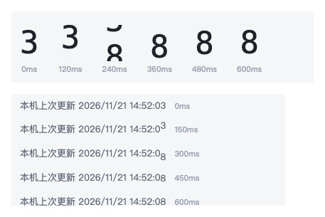

# 上次更新时间 UI 自检记录

- 日期：2026-11-18
- 范围：数据状态条中的「上次更新」
- 基调：沿用插件既有 13px 中性灰、表格数字；不移动状态区、不新增强调色、不加依赖。
- 改动：采用定宽字符滚动，仅新旧值不同的数字位上下滚动；日期分隔符和相同数字位静止。日期时间固定为 `YYYY/MM/DD HH:mm:ss`，跨日/跨年字符位置稳定。空闲时更新时间从状态栏左侧开始；刷新或切换数据源时显示对应提示。
- 动效：为消除交接闪光，移除 3D 背面和半片裁切层。旧值与新值在同一 600ms、同一条 `cubic-bezier(.4,0,.2,1)` 上同时滚动：旧位移出 `-100%`，新值从 `+100%` 滚到位，两位始终首尾相接，中途不会出现空白帧；数字层不再涂 `--d-surface` 底色，滚动时不会在浅灰状态条上闪出白块。`prefers-reduced-motion` 下直接显示新数字。
- 无障碍：整个 `<time>` 用 `aria-label` 暴露完整时间，各字符 `aria-hidden`，避免每位重复朗读。
- 生命周期：时间字符串变化时开始 600ms 过渡，700ms 后清理旧层；后续变化清除过期 timer；组件卸载清理 timer。
- 验证：测试覆盖首屏、秒位单字符变化、快速更新、跨午夜/年份、无障碍标签、600ms 滚动期间保留旧层、700ms 后清理、timer 清理；CSS 断言两条动画时长相同且无第二段延迟、无遗留半片层。逐帧证据见 `updated-time-roll-frames.png`（用 `src/panel.css` 的真实规则冻结 0/120/240/360/480/600ms，并在 13px 状态条内复现），可见任意时刻都有字形在窗口内，没有空白间隙或白色底块。
- 结论：滚动交接与逐帧渲染已用真实 CSS 在浏览器中取证；仍未在运行中的 DSH 面板里点一次刷新观察全程，因此不标记视觉终验完成，也未独立评审。

## 刷新时整行闪动（2026-11-21）

- 现象：每次刷新/切换数据源，整段时间文字都会快速右移再弹回，读起来像"整个时间闪一下"，与数字滚动无关。
- 复现：用 React 18 加载 `src/client.js` 里真实的 `UpdatedTime` 与状态栏结构，套 `src/panel.css` 真实规则，逐帧记录 `.d-update-time` 的 `getBoundingClientRect()`。旧顺序在 `busy` 置位那一帧把时间从 x=34 推到 x=96.39（62.4px），300ms 后弹回。
- 原因：`正在刷新…` 渲染在时间之前，它出现/消失都会把时间整段推开；`.d-refresh-state` 的 `margin-right` 也参与了这个位移。
- 修正：状态行改为「上次更新 → 刷新/切换提示 → 备注」，时间永远贴左；提示文案前面自带 ` · ` 分隔，`.d-refresh-state` 只保留 `white-space: nowrap`。修正后同一复现脚本里 x 恒为 34，滚动动画照常。
- 证据：`updated-time-refresh-shift.png` 上为旧顺序（时间被推右），下为新顺序（时间对齐红线）。

## 状态栏左对齐修正（2026-11-18）

- 基调与骨架：沿用现有字体、灰阶、圆角和数据页结构；仅调整状态文案的占位与间距，不新增设计令牌。
- 自检：去掉空闲状态的 9em 固定宽度及单空格占位；刷新/切换时显示对应文字，和时间间隔为 8px；保留更新时间翻页及减少动态效果的处理。
- 验证：108 项测试通过，客户端体积及发布包检查通过；覆盖空闲无占位、刷新提示、切换提示及时间组件继续挂载。最终补充空闲占位断言后，15 项请求测试再次通过。
- 限制：未验证当前 DSH 运行页面，无法确认窄屏断行与动画实际观感；独立评审子代理未能执行完成，未独立评审。当前工作区改动尚未确认加载到运行中的插件。